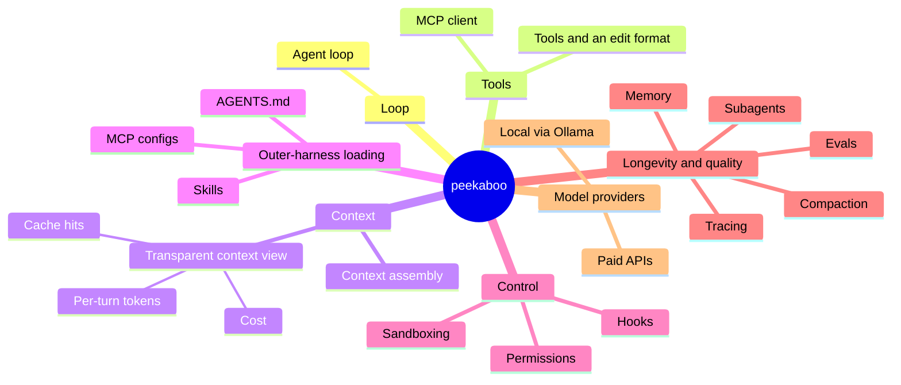
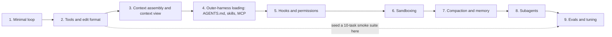
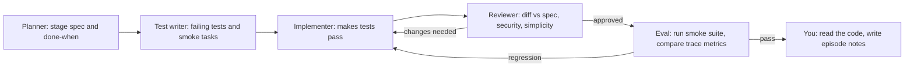
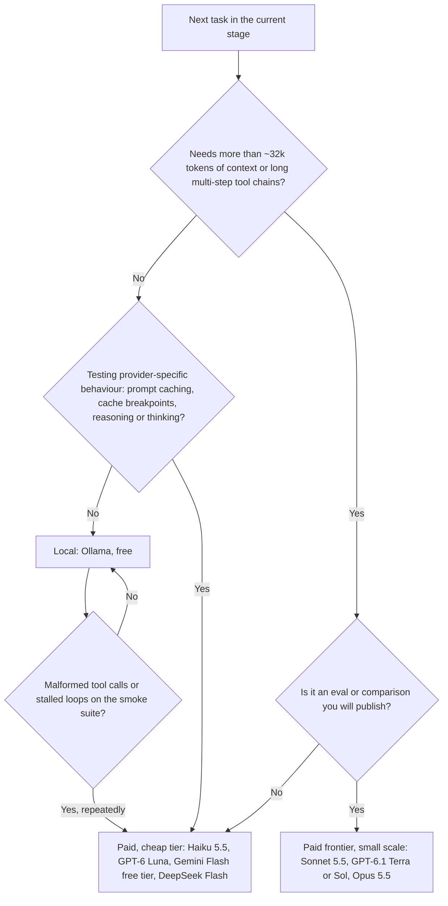

# peekaboo gameplan

> Exported from the project gameplan on 2 Nov 2026.

> 🧭 A staged plan for building a learning-grade **inner harness**: the runtime around the model that turns an LLM into a coding agent. No harness code here, only plans, explanations and verified pointers. Every link was checked on 31 Oct 2026.

## 1. What an inner harness is

Your outer harness is *configuration*: AGENTS.md, skills folders, hooks, rules and MCP server lists. The inner harness is the *runtime* that reads that config and runs the agent. It does five things:

- **Loop**: call the model, run any tools it asks for, append the results and repeat until it replies with no tool call.
- **Context assembly**: decide exactly which tokens go into each request (system prompt, instructions, tool schemas, history, tool output) and in what order. Order matters for prompt caching.
- **Tools**: a registry, a dispatcher, an edit format, and an MCP client for external tools.
- **Control**: hooks, permission gates and a sandbox, so that tool calls run within limits you set.
- **Longevity and quality**: compaction, memory, subagents, tracing and evals.

Cursor puts it as *harness = instructions + tools + model*, with the harness tuned to each model ([Cursor: agent best practices](https://cursor.com/blog/agent-best-practices)). OpenAI's [Unrolling the Codex agent loop](https://openai.com/index/unrolling-the-codex-agent-loop/) is the clearest first-party walkthrough of a real one.

**The loop shape (pseudocode, nothing more):**

```txt
messages = assemble_context(config, user_input)
loop:
    response = model.stream(messages, tools)
    record(tokens, cost, cache_hits)          # feeds the context view
    if response has no tool_calls: break
    for call in response.tool_calls:
        result = gate(call) → sandbox.run(call) → truncate(result)
        messages.append(call, result)
    maybe_compact(messages)
```

### Feature map

The architecture is not decided yet; this map only groups the features peekaboo will have.



### Differentiating angle: the transparent context view

Most agents hide the prompt. Yours shows it. On every turn, render the assembled request as labelled segments (system, AGENTS.md, skill metadata, tool schemas, history, tool results), each with its token count, the cache-hit and cache-write split, and the running cost. This is a natural fit for your data-platform background: treat every turn as an event row and the context view as a query over the trace. It's also the best teaching tool for the content series, because each later stage visibly changes the picture.

## 2. The gameplan



> ⚠️ **One change to the suggested order:** don't leave evals entirely to the end. Seed a tiny smoke suite at Stage 2 (10 small tasks and a pass/fail script) and run it after every stage. Stage 9 then turns that seed into a proper eval harness. Anthropic, Cursor and Hamel Husain all treat measurement as the thing that drives harness work, not the last step.

### Stage 1: Minimal agent loop

- **Done when:** a CLI takes a prompt, streams the reply, offers one tool (`read_file` or `bash`), executes tool calls, feeds results back and stops when the model replies without a tool call. It also has a max-turns guard and writes a JSONL transcript.
- **You learn:** the tool-use protocol end to end (tool schema → `tool_use` block → `tool_result` with matching ID), stop reasons, streaming events, and why the API is stateless, so you resend the full history each turn.
- **Read:** [Thorsten Ball: How to build an agent](https://ampcode.com/notes/how-to-build-an-agent) · [Claude tool use overview](https://platform.claude.com/docs/en/agents-and-tools/tool-use/overview) · [Unrolling the Codex agent loop](https://openai.com/index/unrolling-the-codex-agent-loop/)
- **Episode angle:** "An agent is a while loop: building one live, from first principles."
- **Pitfalls:** mismatched tool-call IDs; dropping the assistant's tool-call message before appending results; not handling parallel tool calls; an infinite loop with no turn or budget cap; parsing partial JSON while streaming.

### Stage 2: Tool registry, file and shell tools, edit format

- **Done when:** tools are registered declaratively (name, description, JSON Schema, handler). You have `read_file` (with line ranges), `list`/`glob`, `grep`, `bash` (with timeout), and an **edit tool** using one format, either exact string-replace or a patch format. Tool errors return as readable results, not crashes. Large outputs are truncated and marked as truncated. The smoke suite exists.
- **You learn:** that tool design is prompt design (names, descriptions, error messages); the agent-computer interface idea from SWE-agent; edit formats and their failure modes; and that models favour the edit format they were trained on (patch for OpenAI models, string replace for Anthropic's, per Cursor).
- **Read:** [Anthropic: Writing effective tools for agents](https://www.anthropic.com/research/writing-tools-for-agents) · [Aider: edit formats](https://aider.chat/docs/more/edit-formats.html) · [SWE-agent paper (ACI)](https://arxiv.org/abs/2405.15793)
- **Episode angle:** "String-replace vs diff vs whole-file: I benchmarked three edit formats on my own smoke suite."
- **Pitfalls:** non-unique `old_string` matches; whitespace and CRLF drift; dumping 50k lines of `grep` output into context; vague tool descriptions; tools that fail silently.

### Stage 3: Context assembly and the transparent context view

- **Done when:** a single `assemble()` step builds each request from named segments in a stable order (stable prefix first, volatile content last). The UI or a `/context` command shows the token count per segment, input, output, cache-read and cache-write tokens, cost per turn and in total, and the percentage of the window used. The trace stores all of it.
- **You learn:** context engineering as a discipline; prompt caching mechanics (prefix match, breakpoints, TTL, why reordering tools breaks the cache); token counting; and how "context rot" shows up long before the hard limit.
- **Read:** [Anthropic: Effective context engineering](https://www.anthropic.com/research/effective-context-engineering-for-ai-agents) · [Claude prompt caching](https://platform.claude.com/docs/en/build-with-claude/prompt-caching) · [Manus: context engineering lessons](https://manus.im/blog/Context-Engineering-for-AI-Agents-Lessons-from-Building-Manus)
- **Episode angle:** "X-ray of a context window: what my agent actually sends each turn, and what it costs."
- **Pitfalls:** timestamps or other volatile text early in the prompt, which kills cache hits; estimating tokens with a local tokeniser instead of reading usage from the API response; forgetting that tool schemas cost tokens on every request.

### Stage 4: Outer-harness loading (AGENTS.md, skills, MCP client)

- **Done when:** the harness discovers AGENTS.md files (repo root and nested, with nearest-file precedence) and loads them into context. It scans skills folders, puts only each skill's name and description into context and loads the full SKILL.md on demand (progressive disclosure). It acts as an MCP client over stdio (initialise, list tools, call tools) and namespaces MCP tools alongside native ones. The context view labels each of these segments.
- **You learn:** open-format interoperability, which is your home turf from the other side; progressive disclosure as a token-budget strategy; MCP lifecycle, capabilities and transports; and dynamic tool loading versus stuffing every schema in up front.
- **Read:** [AGENTS.md](https://agents.md/) · [Agent Skills specification](https://agentskills.io/specification) · [MCP specification (latest)](https://modelcontextprotocol.io/specification/latest)
- **Episode angle:** "One config, any agent: making my harness read the same AGENTS.md and skills as the big tools."
- **Pitfalls:** loading every MCP tool schema eagerly (Cursor reports big token savings from loading them dynamically); untrusted skill or MCP content becoming a prompt-injection vector; stdio servers that hang on start-up; name collisions between tools.

### Stage 5: Hooks and permissions

- **Done when:** lifecycle events (session start, user prompt submit, pre-tool-use, post-tool-use, stop) fire configurable hooks that can block, modify or annotate. A permission layer applies allow, ask and deny rules per tool and argument pattern, with modes (read-only, ask-every-time, auto-approve within sandbox). Every decision is logged in the trace.
- **You learn:** deterministic control around a non-deterministic core; hook I/O contracts (stdin JSON, exit codes); the "lethal trifecta" threat model (private data + untrusted content + exfiltration channel).
- **Read:** [Claude Code hooks reference](https://code.claude.com/docs/en/hooks) · [Simon Willison: The lethal trifecta](https://simonwillison.net/2025/Jun/16/the-lethal-trifecta/) · [Codex CLI repo](https://github.com/openai/codex) (approval modes)
- **Episode angle:** "Guardrails as code: hooks that stop my agent doing something stupid."
- **Pitfalls:** treating permission prompts as security (approval fatigue); regex allow-lists that `bash -c` can bypass; hooks that are slow or can deadlock the loop.

### Stage 6: Sandboxing

- **Done when:** shell and file tools run inside an isolation boundary, either an OS-level sandbox (bubblewrap on Linux, Seatbelt on macOS) or a container, with the filesystem restricted to the workspace and network egress denied or allow-listed. Violations surface to the model as tool errors. An "auto-approve inside sandbox" mode works.
- **You learn:** why sandboxing reduces permission prompts rather than adding friction; filesystem versus network isolation; and the trade-offs between containers and OS primitives.
- **Read:** [Anthropic: Making Claude Code safer with sandboxing](https://www.anthropic.com/research/claude-code-sandboxing) · [anthropics/sandbox-runtime](https://github.com/anthropics/sandbox-runtime) · [Simon Willison: Designing agentic loops](https://simonwillison.net/2025/Sep/30/designing-agentic-loops/)
- **Episode angle:** "Letting the agent run free in a box: YOLO mode, safely."
- **Pitfalls:** forgetting network isolation (exfiltration); leaking environment variables or credentials into the sandbox; child processes escaping the timeout.

### Stage 7: Compaction and memory

- **Done when:** near a configurable threshold the harness compacts. It clears old tool results first, then summarises older turns into a structured summary while keeping recent turns verbatim. The context view shows before and after. A file-based memory (notes or a progress file the agent reads and writes) persists across sessions. Long tasks survive several compactions with the smoke suite still passing.
- **You learn:** the different compaction strategies (tool-result clearing, summarisation, structured note-taking, offloading to files); the MemGPT idea of tiered memory; and how compaction interacts with caching.
- **Read:** [Claude compaction overview](https://platform.claude.com/docs/en/build-with-claude/compaction) · [Anthropic: Effective harnesses for long-running agents](https://www.anthropic.com/research/effective-harnesses-for-long-running-agents) · [MemGPT paper](https://arxiv.org/abs/2310.08560)
- **Episode angle:** "What does my agent forget? Diffing context before and after compaction."
- **Pitfalls:** summaries that drop the current goal, file paths or failing test names; compacting mid-tool-call and orphaning IDs; memory files growing without bound; cache misses after every compaction.

### Stage 8: Subagents (the harness gains multi-agent)

- **Done when:** a `task`/`delegate` tool spawns a subagent with its own fresh context, a restricted tool set and an optional different model. The subagent returns a condensed result, and the parent's context view shows only that result. Subagents can be defined from outer-harness config (for example, markdown files with frontmatter).
- **You learn:** context isolation as the main benefit; the coordination tax; and when parallel read-only exploration helps and parallel writers hurt.
- **Read:** [Anthropic: How we built our multi-agent research system](https://www.anthropic.com/research/multi-agent-research-system) · [Cognition: Don't build multi-agents](https://cognition.com/blog/dont-build-multi-agents) · [Claude Code subagents](https://code.claude.com/docs/en/sub-agents)
- **Episode angle:** "Multi-agent: the case for and against, measured on my own harness."
- **Pitfalls:** subagents with conflicting implicit decisions; parallel writers editing the same files; token cost multiplying (Anthropic reports multi-agent runs use many times the tokens of chat); unbounded recursion.

### Stage 9: Evals and tuning

- **Done when:** a runner executes a task set (your smoke suite plus a small SWE-bench-style or Terminal-Bench-style slice) in clean sandboxes. It grades with deterministic checks (tests pass) first, then LLM-as-judge for softer criteria, and reports pass rate, cost, tokens, turns and tool-error rate per harness variant. You can A/B a change, such as a new edit format or compaction threshold, and see the delta.
- **You learn:** error analysis before metrics; grader design; variance and the need for repeated trials; and harness tuning as an empirical loop, which is exactly how Cursor describes its own work.
- **Read:** [Anthropic: Demystifying evals for AI agents](https://www.anthropic.com/research/demystifying-evals-for-ai-agents) · [Hamel Husain: Your AI product needs evals](https://hamel.dev/blog/posts/evals/) · [Cursor: Continually improving our agent harness](https://cursor.com/blog/continually-improving-agent-harness)
- **Episode angle:** "Does my harness actually get better? Building the scoreboard."
- **Pitfalls:** chasing a public benchmark number instead of reading traces; single runs on noisy tasks; graders that reward the wrong thing; data contamination on public benchmarks.

## 3. Where multi-agent build loops fit

Multi-agent shows up twice: **how you build** each stage, and **what you build** at Stage 8. Keep them separate in your head and in the episodes.

### Building each stage with an agent loop



- **Spec first.** For each stage, write a short spec page with the milestone, interfaces and non-goals, and make it the planner's output. The "Done when" lines above are ready-made acceptance criteria.
- **Test-driven loop.** Have one agent write failing tests and smoke tasks *before* implementation. The implementer's only job is to turn them green. This keeps the implementer honest.
- **Independent reviewer.** Use a fresh context (and ideally a different model) for review, so it doesn't share the implementer's blind spots. Give it the spec and the diff, not the implementer's transcript.
- **Eval gate.** After every stage, run the smoke suite and compare pass rate, tokens and cost with the previous stage. Your own context view is now telemetry for the build.
- **You stay the author.** You write the code (the agents help you plan, test and review), so read every diff and capture the "why" for the episode.
- **Dogfood from Stage 4 on.** Once your harness loads AGENTS.md and skills, use the *same* outer-harness config to drive both your everyday tools and your own harness. That makes a good mid-series episode.

### When the harness itself gets subagents (Stage 8)

By then you will have used planner, implementer and reviewer roles yourself, so Stage 8 is the moment to encode one of those roles *inside* the harness, for example a read-only "explorer" subagent or a "reviewer" subagent that sees only the diff. Measure with Stage 9 evals whether it helps; don't assume.

## 4. Costs

> 💷 **Read this first.** All prices are in USD, taken from official pricing pages **checked on 31 Oct 2026**. **Every cost figure in this section is an ESTIMATE** built on the stated assumptions. Prices move fast, and several below carry promotional end dates, so re-check the linked page before you spend.

**The short version:** build Stages 1, 2, 5 and 6 on free local models. Use cheap paid models for Stages 3, 4 and 8. Spend on frontier models only for long-context compaction tests and the eval runs you'll publish. On that mix, the whole programme comes to about **\$40 (ESTIMATE)**.

### 4.1 Local or paid? A decision flow



### 4.2 What's free: local models via Ollama

- **Tool calling is first-class.** Ollama's [tool-calling docs](https://docs.ollama.com/capabilities/tool-calling) cover single, parallel and multi-turn tool calls, plus streaming. The multi-turn example is essentially your Stage 1 loop. To find candidates, filter the library by the [tools tag](https://ollama.com/search?c=tools). Many top entries are tagged "cloud", which means hosted rather than local.
- **The context-length trap.** Ollama sets the default context from your VRAM: 4k under 24 GiB, 32k for 24–48 GiB and 256k from 48 GiB. It recommends **at least 64,000 tokens for agents and coding tools** ([context length](https://docs.ollama.com/context-length)). A silent 4k window truncates history and looks like the model being stupid, so show the effective `num_ctx` in your context view.
- **Hardware.** NVIDIA needs compute capability 5.0+ and driver 550+. AMD runs on ROCm v7, with Vulkan as a fallback, and Apple Silicon runs on Metal ([hardware support](https://docs.ollama.com/gpu)). Apple Silicon's unified memory lets the GPU use system RAM, so a 32 GB+ Mac is a practical 20–30B-class machine. On a PC, VRAM is the hard limit. Check `ollama ps`: the PROCESSOR column should read 100% GPU, because CPU offload is slow.

**Candidate local models with tool support.** Download sizes are for the default tag on each model's Ollama page.

| Model (Ollama) | Download | Max context | Tool-calling evidence |
| --- | --- | --- | --- |
| [qwen3:8b](https://ollama.com/library/qwen3) | 5.2 GB | 40K | BFCL V4: Qwen3-8B (FC) 42.57% |
| [qwen3:14b](https://ollama.com/library/qwen3) | 9.3 GB | 40K | BFCL V4: Qwen3-14B (FC) 41.03% |
| [qwen3:30b](https://ollama.com/library/qwen3) (MoE) | 19 GB | 256K | BFCL V4: Qwen3-30B-A3B-Instruct-2507 (FC) 41.39% |
| [qwen3:32b](https://ollama.com/library/qwen3) | 20 GB | 40K | BFCL V4: Qwen3-32B (FC) 48.71%, the best open model of this size on the snapshot |
| [mistral-small3.2:24b](https://ollama.com/library/mistral-small3.2) | 15 GB | 128K | BFCL V4: Mistral-small-2506 (FC) 37.15% |
| [gpt-oss:20b](https://ollama.com/library/gpt-oss) | 14 GB | 128K | Tagged tools and thinking; not on the BFCL snapshot |
| [qwen3-coder:30b](https://ollama.com/library/qwen3-coder) | 19 GB | 256K | Tagged tools; coding-tuned; not on BFCL |
| [devstral:24b](https://ollama.com/library/devstral) | 14 GB | 128K | Tagged tools; agentic-coding model; not on BFCL |
| [qwen3.8:27b](https://ollama.com/library/qwen3.8) | 18 GB | 256K | Tagged tools; newest Qwen; vendor claims only |
| [flint:40b](https://ollama.com/library/flint) (MoE) | 23 GB | 256K | Tagged tools; "built for coding agents" per model card; vendor claims only |

For scale on [BFCL V4](https://gorilla.cs.berkeley.edu/leaderboard.html) (last updated 12 Apr 2026), Claude-Opus-4-5 (FC) scores 77.47%, Claude-Haiku-4-5 (FC) 68.70% and GPT-5-mini (FC) 55.46%. Small local models are clearly weaker at multi-turn tool use, which is exactly what your smoke suite will show. Newer models (qwen3.8, flint, gpt-oss) aren't on the snapshot, so test them yourself.

**Rough hardware tiers (ESTIMATE).** Plan for the download size, plus several GB of KV cache at 32–64k context, plus OS headroom.

- **16 GB RAM/VRAM:** 8–9B models (qwen3:8b) at modest context. Fine for Stages 1–2.
- **24 GB GPU or 32 GB Apple Silicon:** 20–30B class (gpt-oss:20b, qwen3:30b, qwen3.8:27b). The sweet spot for Stages 1–6.
- **48–64 GB+:** 30–40B MoE at long context (flint:40b, qwen3-coder:30b at 64k+), and Ollama's 256k default kicks in from 48 GiB VRAM.

### 4.3 When paid models are genuinely worth it

| Stage | Local is fine? | Where paid models earn their keep |
| --- | --- | --- |
| 1 Minimal loop | Yes | Not needed |
| 2 Tools and edit format | Mostly | One paid run to compare edit-format adherence; small models fumble exact string-replace |
| 3 Context view | View: yes | **Real prompt-caching behaviour** (cache read/write tokens, breakpoints, TTLs) only exists on paid APIs |
| 4 AGENTS.md, skills, MCP | Mostly | Choosing well among many MCP tools needs a stronger model |
| 5 Hooks and permissions | Yes | Not needed: the logic is deterministic |
| 6 Sandboxing | Yes | Not needed |
| 7 Compaction and memory | No | **Long context (100k+)** and good summaries; local defaults cap context by VRAM |
| 8 Subagents | Partly | Cheap paid models for subagents; a stronger orchestrator if delegation quality matters |
| 9 Evals | Smoke runs | **Headline comparisons and published numbers**; use batch APIs at a 50% discount |

### 4.4 Price sheet (USD per million tokens, checked 31 Oct 2026)

| Provider | Model | Input | Cache read | Cache write | Output | Notes |
| --- | --- | --- | --- | --- | --- | --- |
| [Anthropic](https://platform.claude.com/docs/en/about-claude/pricing) | Claude Haiku 5.5 | \$0.10 | \$0.01 | \$0.125 (5 min) | \$0.50 | Prompts over 100k tokens: \$0.50 in / \$2.50 out |
| Anthropic | Claude Sonnet 5.5 | \$2 | \$0.10 | \$2.50 (5 min) | \$10 | 1M context at standard price |
| Anthropic | Claude Opus 5.5 | \$4 | \$0.20 | \$5 (5 min) | \$20 |  |
| [OpenAI](https://developers.openai.com/api/docs/pricing) | GPT-6 Luna | \$0.10 | \$0.01 | \$0.125 (30 min) | \$0.50 | Short context ≤272K |
| OpenAI | GPT-6.1 Terra | \$1 | \$0.05 | \$1.25 (30 min) | \$5 |  |
| OpenAI | GPT-6.1 Sol | \$2 | \$0.10 | \$2.50 (30 min) | \$10 |  |
| [Google](https://ai.google.dev/gemini-api/docs/pricing) | Gemini 3.8 Flash | \$0.75 | \$0.075 + storage | n/a | \$3.75 | **Doubles from 1 Jan 2027**; has a free tier |
| Google | Gemini 4 Argon | \$2 | \$0.10 | Implicit only | \$10 | **\$4 / \$20 from 1 Dec 2026**; no free tier |
| [DeepSeek](https://api-docs.deepseek.com/quick_start/pricing) | deepseek-flash | \$0.30 peak / \$0.15 off-peak | \$0.006 / \$0.003 | n/a | \$1.20 / \$0.60 | Peak: 01:00–04:00 and 06:00–10:00 UTC on weekdays |
| [Mistral](https://docs.mistral.ai/inference/pricing) | Mistral Small 4 | \$0.15 | \$0.015 | n/a | \$0.60 | Large 4: \$0.70 / \$0.07 / \$2.10 |
| [Groq](https://console.groq.com/docs/models) | gpt-oss-120b / qwen3.8-27b | \$0.15 / \$0.80 | n/a | n/a | \$0.60 / \$4.00 | Open models at high speed |
| [OpenRouter](https://openrouter.ai/pricing) | Many | Provider list price | Varies | Varies | Provider list price | 5.5% fee on credit purchases (Standard plan) |

Output prices include reasoning or thinking tokens where a model uses them. Anthropic notes that Claude 4.7+ tokenisers produce about 30% more tokens for the same text, so token counts aren't portable across providers.

### 4.5 Per-stage cost estimates (all figures are ESTIMATES)

> 🧮 **Assumptions.**
>
> - A *call* is one model request inside the loop.
> - *Avg input* is the whole resent context per call (system prompt, tools and history).
> - *Sessions* are dev and debug runs for that stage. Stage 9 is 10 eval runs × 30 tasks.
> - **80% of input tokens are cache reads** (realistic only after Stage 3 makes your prefix stable). The other 20% is billed at the 5- or 30-minute cache-write rate.
> - Thinking is off or low; Gemini cache storage and DeepSeek off-peak discounts are ignored.
> - Haiku 5.5 stays under its 100k-token price threshold on average.

| Stage | Calls / session | Avg input / call | Avg output / call | Sessions | Haiku 5.5 (ESTIMATE) | Sonnet 5.5 (ESTIMATE) | GPT-6.1 Terra (ESTIMATE) | Gemini 3.8 Flash (ESTIMATE) | DeepSeek Flash peak (ESTIMATE) |
| --- | --- | --- | --- | --- | --- | --- | --- | --- | --- |
| 1 Minimal loop | 10 | 4k | 400 | 20 | \$0.07 | \$1.26 | \$0.63 | \$0.47 | \$0.15 |
| 2 Tools and edit format | 20 | 10k | 600 | 30 | \$0.38 | \$7.08 | \$3.54 | \$2.61 | \$0.82 |
| 3 Context view and caching | 25 | 20k | 600 | 30 | \$0.72 | \$13.20 | \$6.60 | \$4.84 | \$1.51 |
| 4 AGENTS.md, skills, MCP | 25 | 25k | 600 | 30 | \$0.84 | \$15.37 | \$7.69 | \$5.62 | \$1.75 |
| 5 Hooks and permissions | 20 | 20k | 500 | 20 | \$0.36 | \$6.64 | \$3.32 | \$2.43 | \$0.76 |
| 6 Sandboxing | 20 | 20k | 500 | 20 | \$0.36 | \$6.64 | \$3.32 | \$2.43 | \$0.76 |
| 7 Compaction and memory | 60 | 60k | 800 | 20 | \$2.86 | \$51.36 | \$25.68 | \$18.72 | \$5.82 |
| 8 Subagents | 40 | 30k | 700 | 20 | \$1.07 | \$19.52 | \$9.76 | \$7.14 | \$2.23 |
| 9 Evals | 25 | 25k | 600 | 300 | \$8.44 | \$153.75 | \$76.88 | \$56.25 | \$17.55 |
| **Total, one model throughout** |  |  |  |  | **\$15** | **\$275** | **\$137** | **\$101** | **\$31** |

What the numbers say (all ESTIMATES):

- **Caching is the biggest lever.** The same Sonnet 5.5 programme with no caching comes to about **\$758**, against \$275 with it. GPT-6 Luna prices match Haiku 5.5's, at about \$15. Opus 5.5 throughout would be about \$550.
- **Evals and compaction are about 75% of the spend.** Those are the two stages to plan budgets around.
- **Recommended mix: about \$41.**
  - Stages 1, 2, 5 and 6 on local models: \$0.
  - Stages 3, 4 and 8 on Haiku 5.5 (or the Gemini free tier): about \$2.60.
  - Stage 7: three-quarters of sessions on Haiku, the rest on Sonnet: about \$15.
  - Stage 9: nine eval runs on Haiku plus one Sonnet comparison: about \$23. Batch APIs would roughly halve the eval part.

### 4.6 Free tiers and credits (verified on official pages, 31 Oct 2026)

| Provider | What's free | Catches |
| --- | --- | --- |
| Ollama (local) | Everything runs on your own hardware | Electricity; limited by RAM/VRAM |
| [Google Gemini API](https://ai.google.dev/gemini-api/docs/pricing) | Free tier on selected models, e.g. Gemini 3.8 Flash and 3.5 Flash-Lite input and output | Free-tier content is used to improve Google products; Gemini 4 Argon isn't on it. The \$300 Google Cloud welcome credit **can't** be used for the Gemini API on accounts opened after 2 Mar 2026 ([billing](https://ai.google.dev/gemini-api/docs/billing)). Limits are shown in AI Studio ([rate limits](https://ai.google.dev/gemini-api/docs/rate-limits)) |
| [OpenRouter](https://openrouter.ai/pricing) | 25+ free models (IDs ending `:free`) | 20 requests/min and 50/day, rising to 1,000/day once you've bought \$10 of credits; failed attempts count ([limits](https://openrouter.ai/docs/api/reference/limits)) |
| [Groq](https://console.groq.com/settings/billing/plans) | \$0 Free plan | The [rate-limits page](https://console.groq.com/docs/rate-limits) lists gpt-oss-120b, gpt-oss-20b and qwen3.8-27b at 30 RPM, 1K requests/day, 8K TPM and 200K tokens/day (the page's own labelling is ambiguous, so check your limits page) |
| [Anthropic](https://platform.claude.com/docs/en/about-claude/pricing) | "A small amount of free credits" for new users, per the pricing FAQ | Amount not stated |
| OpenAI | **None verified** on the official pricing or limits pages | New API accounts are prepaid with a \$5 minimum |
| DeepSeek | **None verified** | Prepaid balance; a "granted balance" is spent first if you have one, but no grant offer is published |
| Mistral | Free consumer plan includes Mistral Studio access ([pricing](https://mistral.ai/pricing)) | No current free API tier limits found on an official page, so treat it as unverified. Paid Pro plans bundle monthly API credits |

### 4.7 Budget guardrails

- **Hard caps in each console.** Set these before writing any code.
  - **Anthropic:** set a spend limit below your tier cap on the Billing page (the Start tier cap is \$500/month). Once you hit your own limit, requests return HTTP 400 ([rate and spend limits](https://platform.claude.com/docs/en/api/rate-limits)).
  - **OpenAI:** organisation- and project-level hard limits return 429 `project_spend_limit_exceeded`. Add spend alerts as well ([spend limits](https://developers.openai.com/api/docs/guides/spend-limits)).
  - **Gemini:** project spend caps are experimental and can overshoot by about 10 minutes of usage. A prepay balance at \$0 stops all keys, and a monthly auto-charge limit caps auto-reloads ([billing](https://ai.google.dev/gemini-api/docs/billing)).
  - **OpenRouter:** per-key credit limits and budgets ([limits](https://openrouter.ai/docs/api/reference/limits)).
  - **LiteLLM proxy:** per-key and per-user budgets ([budgets](https://docs.litellm.ai/docs/proxy/users)).
- **Prepay small and turn auto-reload off.** A prepaid balance is the simplest hard cap: top up \$5–10 at a time.
- **Develop on small models.** Use Haiku 5.5, GPT-6 Luna, Gemini Flash (free tier) or DeepSeek Flash, and switch to frontier models only for the runs that need them (see 4.3).
- **Prompt caching from Stage 3.** Keep the prefix stable and append-only, and never reorder tools. Docs: [Anthropic](https://platform.claude.com/docs/en/build-with-claude/prompt-caching), [OpenAI](https://developers.openai.com/api/docs/guides/prompt-caching), [Gemini](https://ai.google.dev/gemini-api/docs/caching), [DeepSeek](https://api-docs.deepseek.com/guides/kv_cache), [OpenRouter](https://openrouter.ai/docs/guides/best-practices/prompt-caching).
- **Batch APIs for evals.** These give 50% off non-interactive runs: [Anthropic batch](https://platform.claude.com/docs/en/build-with-claude/batch-processing), [OpenAI batch](https://developers.openai.com/api/docs/guides/batch), [Gemini batch](https://ai.google.dev/gemini-api/docs/batch-api).
- **Cap output on every call.** Set `max_tokens` / `max_output_tokens`, and limit reasoning effort, since thinking tokens bill as output. OpenRouter even reserves budget against `max_tokens` before a request runs.
- **A meter inside the harness, as part of Stage 3.** Normalise each response's usage into one record (uncached input, cache write, cache read, output, reasoning). Price it from a versioned local price table that stores the date checked. Show per-turn and session cost, plus cache hit rate, in the context view. Enforce a **session budget and a daily budget**: before each call, estimate the worst case (input plus `max_tokens`) and refuse if it would breach the limit.
- **Stop runaway loops.** Use several limits together:
  - a maximum number of turns per task and tool calls per turn
  - a wall-clock timeout
  - a cap on consecutive tool errors
  - detection of the same tool call repeated with identical arguments
  - limits on subagent depth and fan-out
  - Log which limit fired, because each one is a useful eval signal.

### 4.8 Provider abstraction: swap models with a config change

Keep a **thin internal model interface** and write one adapter per provider. No harness code here, just the shape:

- **Messages:** role plus typed content blocks (text, image, tool call, tool result, reasoning).
- **Tools:** name, description and JSON Schema, translated per provider.
- **Streaming:** a single event stream (text delta, tool-call delta, usage, stop reason).
- **Usage:** one normalised record. The semantics differ, and this is easy to get wrong:
  - **Anthropic:** `input_tokens` excludes cache reads and writes, so total input = cache read + cache creation + input tokens.
  - **OpenAI:** `input_tokens` includes cached tokens.
  - Getting this wrong silently breaks your cost meter.
- **Capabilities:** flags such as `prompt_caching`, `explicit_cache_breakpoints`, `reasoning`, `parallel_tools` and `max_context`. The harness asks what's supported instead of assuming.

| Option | Good for | Trade-offs |
| --- | --- | --- |
| Native adapters (Anthropic Messages, OpenAI Responses, Gemini, Ollama `/api/chat`) | Full feature access; the best way to learn each protocol | More code to maintain |
| [Ollama's OpenAI-compatible endpoint](https://docs.ollama.com/api/openai-compatibility) | One OpenAI-style adapter covers local models | Supports only a subset of the API: no `tool_choice`, stateless Responses only, and context length must be set via a Modelfile or server setting |
| OpenAI-compatible providers (Groq, DeepSeek, OpenRouter) | Reuse the same adapter; DeepSeek also offers an Anthropic-format endpoint | Caching and reasoning fields differ per provider |
| [LiteLLM](https://github.com/BerriAI/litellm) | One SDK or proxy across many providers, with budgets and rate limits | Another dependency, and the abstraction leaks: provider-specific parameters and usage fields don't always map cleanly |
| [OpenRouter](https://openrouter.ai/pricing) | One key, hundreds of models, fallback routing | 5.5% fee on credit purchases, no prompt caching on the free plan, and the serving provider can vary, which hurts cache affinity and consistency |

**The lowest-common-denominator risk.** If everything goes through one generic API, you lose exactly what the series is about: Anthropic `cache_control` and OpenAI `prompt_cache_breakpoint` placement, cache TTL choices, reasoning or thinking items that must be passed back on the next turn, and provider server tools.

**Recommendation:**

- Use native adapters for Anthropic and OpenAI, where you'll study caching.
- Use the OpenAI-compatible adapter for Ollama, Groq, DeepSeek and OpenRouter.
- Select the provider and model per stage, or per subagent, in config.
- **Episode angle:** "What does an agent run cost? The same task on five providers, metered turn by turn."

## 5. Which open-source agents to read, and when

| Stage | Read first | Why |
| --- | --- | --- |
| 1 | [How to build an agent (Amp)](https://ampcode.com/notes/how-to-build-an-agent), [mini-swe-agent](https://github.com/SWE-agent/mini-swe-agent) | Smallest honest loops; mini-swe-agent is about 100 lines and bash-only |
| 2 | [Aider](https://github.com/Aider-AI/aider), [SWE-agent](https://github.com/SWE-agent/SWE-agent) | Edit formats, repo map, agent-computer interface design |
| 3–4 | [Codex CLI](https://github.com/openai/codex), [opencode](https://github.com/anomalyco/opencode) | Context assembly, AGENTS.md handling, caching-aware request building, MCP |
| 5–6 | [Codex CLI](https://github.com/openai/codex), [gemini-cli](https://github.com/google-gemini/gemini-cli), [sandbox-runtime](https://github.com/anthropics/sandbox-runtime) | Approval modes, OS-level sandboxing |
| 7–8 | [OpenHands](https://github.com/OpenHands/OpenHands), [Goose](https://github.com/aaif-goose/goose), [Cline](https://github.com/cline/cline) | Condensers and memory, extension/MCP-first design, plan/act modes |
| 9 | [SWE-bench](https://www.swebench.com/), [Terminal-Bench](https://www.tbench.ai/), [Inspect](https://inspect.aisi.org.uk/) | Task sets and eval frameworks |

## 6. Source library

Credibility: **High** = official docs or spec, a widely cited paper, or a maintained primary repo. **Medium** = a recognised practitioner or well-maintained community resource. **Low** = single or unverified source; use with care.

### Official docs and specs

| Source | What it's good for | Stage | Credibility |
| --- | --- | --- | --- |
| [Claude: Tool use overview](https://platform.claude.com/docs/en/agents-and-tools/tool-use/overview) | Tool schemas, tool\_use / tool\_result protocol | 1–2 | High: official API docs |
| [Claude: Streaming messages](https://platform.claude.com/docs/en/build-with-claude/streaming) | SSE event types, streaming tool input | 1 | High: official API docs |
| [Claude: Prompt caching](https://platform.claude.com/docs/en/build-with-claude/prompt-caching) | Cache breakpoints, prefix rules, cache tokens in usage | 3 | High: official API docs |
| [Claude: Token counting](https://platform.claude.com/docs/en/build-with-claude/token-counting) | Pre-flight token counts for the context view | 3 | High: official API docs |
| [Claude: Context editing](https://platform.claude.com/docs/en/build-with-claude/context-editing) | Clearing stale tool results | 7 | High: official API docs |
| [Claude: Compaction overview](https://platform.claude.com/docs/en/build-with-claude/compaction) | Summarisation-based compaction design | 7 | High: official API docs |
| [Claude: Memory tool](https://platform.claude.com/docs/en/agents-and-tools/tool-use/memory-tool) | File-backed memory as a tool | 7 | High: official API docs |
| [Claude Code: Hooks reference](https://code.claude.com/docs/en/hooks) | Hook events, I/O contract, blocking semantics | 5 | High: official product docs |
| [Claude Code: Sandboxing](https://code.claude.com/docs/en/sandboxing) | Filesystem and network sandbox configuration | 6 | High: official product docs |
| [Claude Code: Subagents](https://code.claude.com/docs/en/sub-agents) | Subagent definitions as config files | 8 | High: official product docs |
| [Claude Code: Best practices](https://code.claude.com/docs/en/best-practices) | How a mature harness is meant to be driven | All | High: official product docs |
| [Claude Agent SDK overview](https://code.claude.com/docs/en/agent-sdk/overview) | Reference architecture for a harness-as-library | 3–8 | High: official SDK docs |
| [OpenAI: Function calling](https://developers.openai.com/api/docs/guides/function-calling) | OpenAI tool-call protocol, for a second provider | 1–2 | High: official API docs |
| [OpenAI: Responses API reference](https://developers.openai.com/api/reference/resources/responses) | Items-based request/response shape | 1, 3 | High: official API docs |
| [OpenAI Agents SDK (Python)](https://openai.github.io/openai-agents-python/) | Agents, handoffs, guardrails abstractions | 5, 8 | High: official SDK docs |
| [OpenAI Agents SDK: Tracing](https://openai.github.io/openai-agents-python/tracing/) | Span and trace model for your trace log | 3, 9 | High: official SDK docs |
| [OpenAI: A practical guide to building agents (PDF)](https://cdn.openai.com/business-guides-and-resources/a-practical-guide-to-building-agents.pdf) | Orchestration patterns and guardrails overview | 1, 8 | High: official guide (fairly high-level) |
| [MCP specification (latest)](https://modelcontextprotocol.io/specification/latest) | Lifecycle, transports, tools/resources/prompts | 4 | High: official spec |
| [MCP: Introduction](https://modelcontextprotocol.io/docs/getting-started/intro) | Concepts before the spec | 4 | High: official docs |
| [MCP spec: Tools (2025-11-25)](https://modelcontextprotocol.io/specification/2025-11-25/server/tools) | tools/list and tools/call details | 4 | High: official spec (check the latest version too) |
| [AGENTS.md](https://agents.md/) | The open instruction-file format | 4 | High: format home page |
| [Agent Skills specification](https://agentskills.io/specification) | SKILL.md format and progressive disclosure | 4 | High: format spec |

### Engineering blogs (first-party)

| Source | What it's good for | Stage | Credibility |
| --- | --- | --- | --- |
| [Anthropic: Building effective agents](https://www.anthropic.com/research/building-effective-agents) | Workflows vs agents; start simple | 1 | High: first-party, widely cited |
| [Anthropic: Effective context engineering for AI agents](https://www.anthropic.com/research/effective-context-engineering-for-ai-agents) | Context as a finite budget; compaction, notes, subagents | 3, 7 | High: first-party |
| [Anthropic: Writing effective tools for agents](https://www.anthropic.com/research/writing-tools-for-agents) | Tool naming, descriptions, response shaping, eval-driven tool design | 2 | High: first-party |
| [Anthropic: Equipping agents with Agent Skills](https://www.anthropic.com/research/equipping-agents-for-the-real-world-with-agent-skills) | Why skills use progressive disclosure | 4 | High: first-party |
| [Anthropic: Code execution with MCP](https://www.anthropic.com/research/code-execution-with-mcp) | Cutting tool-schema and result tokens | 4 | High: first-party |
| [Anthropic: Advanced tool use](https://www.anthropic.com/research/advanced-tool-use) | Tool search and deferred tool loading | 4 | High: first-party (also partly a feature announcement) |
| [Anthropic: Making Claude Code safer with sandboxing](https://www.anthropic.com/research/claude-code-sandboxing) | OS-level sandbox design rationale | 6 | High: first-party |
| [Anthropic: Effective harnesses for long-running agents](https://www.anthropic.com/research/effective-harnesses-for-long-running-agents) | Progress files, multi-session work | 7 | High: first-party |
| [Anthropic: How we built our multi-agent research system](https://www.anthropic.com/research/multi-agent-research-system) | Orchestrator-worker design, token economics | 8 | High: first-party |
| [Anthropic: Demystifying evals for AI agents](https://www.anthropic.com/research/demystifying-evals-for-ai-agents) | Agent eval design, graders, trials | 9 | High: first-party |
| [Claude: Building agents with the Claude Agent SDK](https://claude.com/resources/articles/building-agents-with-the-claude-agent-sdk) | Gather context → act → verify loop | 1–3 | High: first-party |
| [OpenAI: Unrolling the Codex agent loop](https://openai.com/index/unrolling-the-codex-agent-loop/) | Real harness loop, stateless requests, caching, compaction | 1, 3, 7 | High: first-party (site blocks scripted fetch; verified via search) |
| [Cursor: Best practices for coding with agents](https://cursor.com/blog/agent-best-practices) | Harness = instructions + tools + model | 1 | High: first-party |
| [Cursor: Continually improving our agent harness](https://cursor.com/blog/continually-improving-agent-harness) | Tool-error taxonomy, online and offline evals, per-model edit tools | 2, 9 | High: first-party |
| [Cursor: Improving the agent for Codex models](https://cursor.com/blog/codex-model-harness) | Matching tools and prompts to model training | 2 | High: first-party |
| [Cursor: Improved token efficiency for longer agent runs](https://cursor.com/blog/improved-token-efficiency) | Cache breakpoints, dynamic tools, subagent cost | 3, 8 | High: first-party |
| [Cursor: Dynamic context discovery](https://cursor.com/blog/dynamic-context-discovery) | Pull-based context rather than stuffing | 3–4 | High: first-party |
| [Cursor: Improving agent with semantic search](https://cursor.com/blog/semsearch) | Retrieval tools alongside grep | 2 | High: first-party |
| [Manus: Context engineering lessons](https://manus.im/blog/Context-Engineering-for-AI-Agents-Lessons-from-Building-Manus) | KV-cache hit rate, masking tools, file system as memory | 3, 7 | Medium: one team's experience, but highly concrete |
| [Cognition: Don't build multi-agents](https://cognition.com/blog/dont-build-multi-agents) | The case against naive multi-agent | 8 | Medium: opinionated practitioner view; read alongside Anthropic's |

### Open-source agents and tutorials

| Source | What it's good for | Stage | Credibility |
| --- | --- | --- | --- |
| [Thorsten Ball: How to build an agent](https://ampcode.com/notes/how-to-build-an-agent) | Minimal loop in a few hundred lines | 1 | Medium: recognised practitioner tutorial |
| [mini-swe-agent](https://github.com/SWE-agent/mini-swe-agent) | \~100-line bash-only agent with strong benchmark results | 1 | High: maintained primary repo (Princeton/Stanford team) |
| [SWE-agent](https://github.com/SWE-agent/SWE-agent) | ACI tools, configurable agent | 2 | High: maintained research repo |
| [OpenAI Codex CLI](https://github.com/openai/codex) | Production harness: sandbox, approvals, AGENTS.md, compaction | 3–7 | High: maintained primary repo |
| [Aider](https://github.com/Aider-AI/aider) | Edit formats, repo map, git integration | 2 | High: mature, widely used |
| [Aider: Edit formats](https://aider.chat/docs/more/edit-formats.html) | whole / diff / udiff compared | 2 | High: primary project docs |
| [Aider: Repository map](https://aider.chat/docs/repomap.html) | Tree-sitter repo map for context | 3 | High: primary project docs |
| [OpenHands](https://github.com/OpenHands/OpenHands) | Event-stream architecture, condensers, sandboxed runtime | 6–8 | High: maintained primary repo |
| [Goose](https://github.com/aaif-goose/goose) | MCP-first extension model | 4 | High: maintained primary repo |
| [opencode](https://github.com/anomalyco/opencode) | TypeScript terminal agent, multi-provider | 3–5 | Medium: popular community repo, fast-moving |
| [Cline](https://github.com/cline/cline) | Plan/act modes, human-in-the-loop approvals, MCP | 5, 8 | Medium: popular community repo |
| [gemini-cli](https://github.com/google-gemini/gemini-cli) | Another first-party CLI harness to compare | 3–6 | High: maintained primary repo |
| [anthropics/sandbox-runtime](https://github.com/anthropics/sandbox-runtime) | OS-level fs and network sandboxing without containers | 6 | High: primary repo |
| [12-factor agents](https://github.com/humanlayer/12-factor-agents) | Principles: own your prompts, context and control flow | 1–5 | Medium: well-known community essay/repo |

### Papers and benchmarks

| Source | What it's good for | Stage | Credibility |
| --- | --- | --- | --- |
| [ReAct (Yao et al., 2022)](https://arxiv.org/abs/2210.03629) | Reason + act loop, the ancestor of the agent loop | 1 | High: widely cited, ICLR 2023 |
| [Toolformer (Schick et al., 2023)](https://arxiv.org/abs/2302.04761) | Models learning to call tools | 1–2 | High: widely cited |
| [SWE-agent (Yang et al., 2024)](https://arxiv.org/abs/2405.15793) | Agent-computer interfaces matter | 2 | High: NeurIPS 2024 |
| [CodeAct (Wang et al., 2024)](https://arxiv.org/abs/2402.01030) | Code as the action space versus JSON tools | 2, 4 | High: ICML 2024 |
| [Lost in the Middle (Liu et al., 2023)](https://arxiv.org/abs/2307.03172) | Position effects in long context | 3 | High: widely cited, TACL |
| [MemGPT (Packer et al., 2023)](https://arxiv.org/abs/2310.08560) | Tiered memory, OS analogy | 7 | High: widely cited |
| [Reflexion (Shinn et al., 2023)](https://arxiv.org/abs/2303.11366) | Verbal self-feedback across attempts | 7, 9 | High: NeurIPS 2023 |
| [SWE-bench (Jimenez et al., 2023)](https://arxiv.org/abs/2310.06770) | The standard coding-agent benchmark | 9 | High: ICLR 2024 |
| [Agentless (Xia et al., 2024)](https://arxiv.org/abs/2407.01489) | A strong non-agentic baseline; keeps you honest | 9 | High: widely cited |
| [SWE-bench site](https://www.swebench.com/) | Leaderboards, Verified and Lite subsets | 9 | High: official benchmark site |
| [Terminal-Bench](https://www.tbench.ai/) | Terminal-task benchmark suited to CLI agents | 9 | High: official benchmark site |
| [Inspect (UK AISI)](https://inspect.aisi.org.uk/) | Open-source eval framework with agent and sandbox support | 9 | High: government-maintained eval framework |

### Practitioners

| Source | What it's good for | Stage | Credibility |
| --- | --- | --- | --- |
| [Lilian Weng: LLM-powered autonomous agents](https://lilianweng.github.io/posts/2023-06-23-agent/) | Planning, memory and tool-use taxonomy | 1, 7 | Medium: recognised expert survey (2023, partly dated) |
| [Simon Willison: Designing agentic loops](https://simonwillison.net/2025/Sep/30/designing-agentic-loops/) | YOLO mode, sandboxes, tool choice | 5–6 | Medium: recognised expert |
| [Simon Willison: The lethal trifecta](https://simonwillison.net/2025/Jun/16/the-lethal-trifecta/) | Prompt-injection threat model | 5 | Medium: recognised expert, widely referenced |
| [Simon Willison: Context engineering](https://simonwillison.net/2025/Jun/27/context-engineering/) | Origin and framing of the term | 3 | Medium: recognised expert (short post) |
| [Simon Willison: ai-agents tag](https://simonwillison.net/tags/ai-agents/) | Ongoing feed of agent developments | All | Medium: curated feed; check dates |
| [Hamel Husain: Your AI product needs evals](https://hamel.dev/blog/posts/evals/) | Eval levels, error analysis first | 9 | Medium: recognised evals practitioner |
| [Hamel Husain: A field guide to rapidly improving AI products](https://hamel.dev/blog/posts/field-guide/) | Trace review, data viewers, iteration loop | 3, 9 | Medium: recognised evals practitioner |
| [LangChain: Context engineering for agents](https://www.langchain.com/blog/context-engineering-for-agents) | Write / select / compress / isolate taxonomy | 3, 7 | Medium: vendor blog, but a useful framework |
| [Drew Breunig: How long contexts fail](https://www.dbreunig.com/2025/06/22/how-contexts-fail-and-how-to-fix-them.html) | Poisoning, distraction, confusion, clash | 3, 7 | Medium: recognised writer on context |
| [Drew Breunig: How to fix your context](https://www.dbreunig.com/2025/06/26/how-to-fix-your-context.html) | Tool loadout, quarantine, pruning, offloading | 4, 7 | Medium: recognised writer on context |
| [Latent Space (swyx)](https://www.latent.space/) | Interviews with agent builders | All | Low–Medium: podcast and newsletter; good for context, check claims against primary sources |

### Costs, local models and providers

| Source | What it's good for | Stage | Credibility |
| --- | --- | --- | --- |
| [Ollama: Tool calling](https://docs.ollama.com/capabilities/tool-calling) | Local tool-use protocol, agent loop, streaming | 1–2 | High: official docs |
| [Ollama: OpenAI compatibility](https://docs.ollama.com/api/openai-compatibility) | Which OpenAI fields work locally | 1, abstraction | High: official docs |
| [Ollama: Context length](https://docs.ollama.com/context-length) | VRAM-based context defaults; 64k+ for agents | 3, 7 | High: official docs |
| [Ollama: Hardware support](https://docs.ollama.com/gpu) | NVIDIA, AMD, Apple Metal and Vulkan support | Setup | High: official docs |
| [Ollama: models with tool support](https://ollama.com/search?c=tools) | Finding local tool-capable models and sizes | 1–2 | High: official library (model claims are the vendors') |
| [Berkeley Function Calling Leaderboard V4](https://gorilla.cs.berkeley.edu/leaderboard.html) | Independent tool-calling accuracy, open vs frontier | Model choice | High: academic benchmark (ICML 2025); snapshot dated 12 Apr 2026 |
| [Anthropic: Pricing](https://platform.claude.com/docs/en/about-claude/pricing) | Model, cache and batch prices; tool-use token overheads | Costs | High: official pricing |
| [Anthropic: Rate and spend limits](https://platform.claude.com/docs/en/api/rate-limits) | Spend caps, cache-aware rate limits, usage semantics | Guardrails | High: official docs |
| [Anthropic: Batch processing](https://platform.claude.com/docs/en/build-with-claude/batch-processing) | 50% off eval runs | 9 | High: official docs |
| [OpenAI: Pricing](https://developers.openai.com/api/docs/pricing) | Model, cache-write and batch prices | Costs | High: official pricing |
| [OpenAI: Spend limits](https://developers.openai.com/api/docs/guides/spend-limits) | Org and project hard caps, alerts | Guardrails | High: official docs |
| [OpenAI: Rate limits](https://developers.openai.com/api/docs/guides/rate-limits) | Usage tiers and monthly usage limits | Guardrails | High: official docs |
| [OpenAI: Prompt caching](https://developers.openai.com/api/docs/guides/prompt-caching) | Breakpoints, TTLs, cost maths, compaction vs cache | 3, 7 | High: official docs |
| [OpenAI: Batch API](https://developers.openai.com/api/docs/guides/batch) | Discounted async eval runs | 9 | High: official docs |
| [Gemini API: Pricing](https://ai.google.dev/gemini-api/docs/pricing) | Free vs paid tiers, promo price dates | Costs | High: official pricing |
| [Gemini API: Billing](https://ai.google.dev/gemini-api/docs/billing) | Prepay, project spend caps, welcome-credit exclusion | Guardrails | High: official docs |
| [Gemini API: Rate limits](https://ai.google.dev/gemini-api/docs/rate-limits) | Tiers and spend-based rate limits | Guardrails | High: official docs |
| [Gemini API: Context caching](https://ai.google.dev/gemini-api/docs/caching) | Implicit and explicit caching | 3 | High: official docs |
| [Gemini API: Batch API](https://ai.google.dev/gemini-api/docs/batch-api) | 50% off async jobs | 9 | High: official docs |
| [DeepSeek: Models and pricing](https://api-docs.deepseek.com/quick_start/pricing) | Low-cost model, peak/off-peak pricing, OpenAI and Anthropic formats | Costs | High: official docs |
| [DeepSeek: Context caching](https://api-docs.deepseek.com/guides/kv_cache) | Automatic disk caching behaviour | 3 | High: official docs |
| [Mistral: API pricing](https://docs.mistral.ai/inference/pricing) | Small/Large model prices, cached input | Costs | High: official docs |
| [Mistral: Pricing plans](https://mistral.ai/pricing) | Free and Pro plans, bundled API credits | Costs | Medium: official, but plan-level marketing page |
| [Groq: Supported models](https://console.groq.com/docs/models) | Prices for fast open-model inference | Costs | High: official docs |
| [Groq: Rate limits](https://console.groq.com/docs/rate-limits) | Free and Developer plan limits | Costs | Medium: official, but the table labelling is ambiguous |
| [Groq: Plans](https://console.groq.com/settings/billing/plans) | Free vs Developer plan features | Costs | High: official page |
| [OpenRouter: Pricing](https://openrouter.ai/pricing) | Fees, free models, plan features | Costs, abstraction | High: official page |
| [OpenRouter: Limits](https://openrouter.ai/docs/api/reference/limits) | Free-model caps, key budgets, in-flight budget | Guardrails | High: official docs |
| [OpenRouter: Prompt caching](https://openrouter.ai/docs/guides/best-practices/prompt-caching) | How caching passes through providers | 3 | High: official docs |
| [LiteLLM (GitHub)](https://github.com/BerriAI/litellm) | Multi-provider SDK and proxy | Abstraction | Medium: popular, well-maintained community project |
| [LiteLLM: Budgets and rate limits](https://docs.litellm.ai/docs/proxy/users) | Per-key and per-user budgets in the proxy | Guardrails | Medium: project docs |
